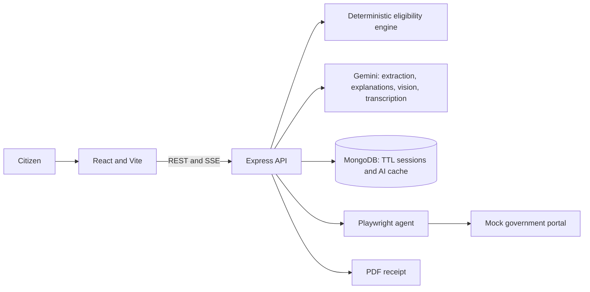
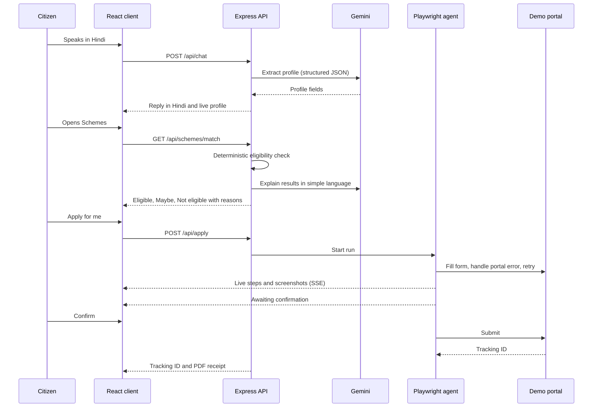

<div align="center">

# Saathi

### Your voice. Your scheme. Done.

**A voice-first, multilingual AI agent that explains government schemes, checks eligibility, and fills the application for you.**

Built for **IDEA//FORGE Online Hackathon** · Track 1: Civic Pulse, Digital Governance & Public Information

[Live Demo](https://saathi-ai07.netlify.app) · [Demo Script](DEMO_SCRIPT.md) · [Deployment Guide](DEPLOY.md)

</div>

---

## The Problem

Government schemes exist for farmers, students, senior citizens and low-income families, but many eligible people never receive the benefits:

- **Language barrier:** notices and portals use formal English or Hindi that many citizens cannot easily read.
- **Confusing eligibility:** rules involve income, land, category, age and documents, written in dense language.
- **Painful applications:** one wrong field format or missing document means rejection and repeated visits, often through paid middlemen.
- **No feedback:** people who are not eligible are rarely told why, or what would make them eligible.

## The Solution

Saathi speaks the citizen's language and does the paperwork with them.

1. **Talk:** speak or type in Hindi, English, Tamil or Bengali.
2. **Understand:** Gemini turns the conversation into a structured profile, shown live.
3. **Match:** a deterministic rules engine checks eligibility, and Gemini explains each result in simple language, including **why not** and **what would need to change**.
4. **Apply:** a Playwright agent fills the application on a demo portal, fixes portal errors by itself, and **waits for the user to confirm** before submitting.
5. **Done:** the user gets a tracking ID and a downloadable PDF receipt.

## Key Features

| Feature | Details |
|---|---|
| Voice-first, multilingual | Hindi, English, Tamil, Bengali. Speech in, spoken replies out, with an audio-upload fallback |
| Reliable eligibility | Rules are plain code. **AI never decides eligibility**, it only extracts facts and explains |
| Plain-language explanations | Short, simple answers at an easy reading level, in the user's language |
| "Why not" guidance | For non-eligible schemes, shows the failed rules and what would change |
| Document understanding | Gemini Vision reads an uploaded certificate; the user reviews before anything is added |
| Autonomous form agent | Playwright fills the form, streams live progress and screenshots, and recovers from portal errors |
| Human in the loop | Review-and-confirm screen before submission |
| Receipt | Tracking ID and downloadable PDF receipt |
| Resilient AI layer | Retry, fallback model, and response caching so the app never crashes on an AI failure |

## Architecture



### Application flow



## Tech Stack

- **Frontend:** React, Vite, Tailwind CSS
- **Backend:** Node.js, Express, Server-Sent Events
- **Database:** MongoDB (TTL-expiring sessions and AI response cache), with an in-memory fallback for demos
- **AI:** Google Gemini (profile extraction, explanations, vision, transcription) with a fallback model
- **Automation:** Playwright (Chromium)
- **Voice:** Web Speech API for recognition and synthesis, plus audio-upload transcription fallback
- **PDF:** pdfkit
- **Deployment:** Docker (Playwright base image), Render / Vercel / MongoDB Atlas

## Responsible AI

- **Deterministic eligibility:** the AI never decides who qualifies. Results are indicative and link to official sources.
- **Human confirmation:** nothing is submitted until the user reviews and confirms.
- **Consent and privacy:** document upload requires consent, and extracted data is added only after review. Full Aadhaar numbers are discarded (last 4 digits at most). Bank numbers are masked and left out of receipts. Sessions expire after 24 hours.
- **No unauthorized automation:** the agent runs only on the included **demo portal**. Real government portals use OTP and CAPTCHA, and automating them requires official permission. The agent logic is portal-agnostic and can be connected to official integrations.
- **Honest limits:** the demo is clearly labeled, and scheme rules are simplified (see below).

## Run Locally

**Requirements:** Node.js 20+. MongoDB is optional (the app uses in-memory sessions without it).

```bash
# 1. Install dependencies
npm install
npm --prefix client install
npm --prefix server install
npm --prefix mock-portal install

# 2. Install the browser used by the agent (if not already installed)
npm --prefix server run install:browser

# 3. Configure environment
cp .env.example .env     # Windows PowerShell: copy .env.example .env
# then add your Gemini API key and model names

# 4. Start client, API and mock portal together
npm run dev
```

| Service | URL |
|---|---|
| Client | http://localhost:5173 |
| API | http://localhost:5000 (health check: `/health`) |
| Mock portal | http://localhost:5001 |

To use Vite hot reload separately, run `npm --prefix client run dev`.

Without a Gemini key, the app stays available with a friendly fallback, but profile extraction, translated explanations, transcription and vision extraction need credentials.

**Browser smoke test** (with the app running):
```bash
npm --prefix server run smoke:browser
```
It opens the client in headless Chromium, checks the Hindi farmer flow, captures console and network errors, and saves screenshots under `server/storage/`.

### Environment variables

| Variable | Purpose |
|---|---|
| `GEMINI_API_KEY` | Gemini API key (never commit this) |
| `GEMINI_MODEL` | Primary model ID |
| `GEMINI_FALLBACK_MODEL` | Fallback model ID, used on rate limits or outages |
| `MONGO_URI` | MongoDB connection string (optional locally) |
| `MOCK_PORTAL_URL` | URL of the demo portal, e.g. `http://localhost:5001` |
| `PORTAL_HICCUP` | `true` makes the demo portal reject the first submit so the agent's error recovery is visible |
| `HEADLESS` | `false` shows the browser while the agent works |
| `PORT` | API port (default 5000) |
| `CLIENT_ORIGIN` | Allowed frontend origin (CORS) |

## Demo Flow

1. Open the app and pick the **farmer** demo chip (or say it in Hindi: *"Main 45 saal ka kisan hoon, Bihar se, do acre zameen hai"*).
2. Watch the profile card fill in and hear the reply.
3. Open **Schemes**: PM-KISAN shows as eligible with a Hindi explanation. Non-eligible schemes explain why not.
4. Optionally upload the sample certificate under **Documents**.
5. Click **Apply for me**: watch the live timeline, the portal error being corrected, then the review screen.
6. Confirm to receive the tracking ID and PDF receipt.

A two-minute presentation script is in [DEMO_SCRIPT.md](DEMO_SCRIPT.md).

## Project Structure

```
client/         React app (chat, schemes, documents, live agent view)
server/         Express API, eligibility engine, Gemini service, Playwright agent
mock-portal/    Demo government portal used by the agent
Dockerfile.server, Dockerfile.portal, docker-compose.yml
DEPLOY.md       Deployment notes
DEMO_SCRIPT.md  Two-minute demo script
```

## Deployment

Docker images are provided for the API and the mock portal, and the frontend deploys as a static Vite app. See [DEPLOY.md](DEPLOY.md) for step-by-step instructions.

## Current Limitations

- Scheme criteria and benefit descriptions are **simplified demo rules**. Each scheme links to its official source, and everything must be verified against current official rules before real-world use.
- UI copy is strongest in English and Hindi; Tamil and Bengali are supported for speech and chat, with less fallback copy.
- Application state and streamed progress are held in memory, so a server restart ends active runs.
- Uploaded documents are processed in memory and not retained.
- Voice recognition works best in Chrome and requires HTTPS when deployed.

## Roadmap

- More schemes and all 22 scheduled languages
- WhatsApp and IVR access for people without smartphones
- Distribution through village service centres (CSCs) and NGOs
- Integration with official government APIs where permission is granted
- Application status tracking and reminders

## Team

**<TEAM NAME>**: Chirag Verma ([@chirag11365](https://github.com/chirag11365))

Built for the IDEA//FORGE Online Hackathon.

> Saathi is a hackathon prototype, not an official government service.
